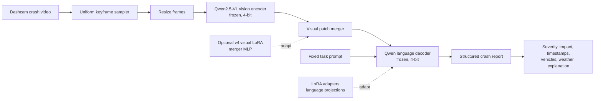
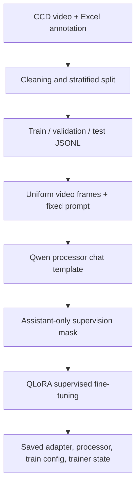

# CrashX: complete project report

**Project status:** Results consolidated from saved artifacts on 11 November 2026.  
**Repository:** `vlm_new_gen`  
**Task:** Generate a structured, evidence-aware report for a dashcam crash video: severity, impact region, crash time window, involved vehicles, weather, and a causal natural-language explanation.

## 1. Executive summary

CrashX adapts **Qwen2.5-VL-7B-Instruct** to structured dashcam accident reporting using 4-bit QLoRA. The completed experiments show that domain adaptation substantially improves report similarity, structured severity/impact prediction, and omission cost against the evaluated zero-shot VLMs.

The strongest balanced historical configuration is **CrashLogic-7B + temporal contrastive decoding (TCD), alpha=0.5**. On the 150-video test split it obtains CIDEr **0.5154**, severity accuracy **0.4867**, impact Jaccard **0.5206**, and Argus omission cost **0.1022**.

The project also contains a newer controlled architecture study. It compares language-only adapters with visual-merger-plus-language adapters, all trained from the same foundation model. The visual-adapter condition is stable over three seeds, with test BERTScore **0.6919 +/- 0.0028** and CIDEr **0.5071 +/- 0.0016**.

The important limitation is temporal localization. A fixed time window chosen from training labels only, `[2.0s, 4.0s]`, reaches test tIoU **0.5178**, higher than all models. Current tIoU therefore cannot be used as evidence of visual temporal grounding.

## 2. Data and task definition

### Dataset

The project uses the Car Crash Dataset (CCD) videos with an Excel annotation layer, `Car_Crash_Text_Dataset_ground_truth.xlsx`.

| Item | Value |
|:---|---:|
| Available cleaned video records | 1,498 |
| Training videos | 1,198 |
| Validation videos | 150 |
| Test videos | 150 |
| Split seed | 42 |
| Raw video directory | `video1500/` |

Each record includes a video identifier/path, severity, impact description, crash start and end time, vehicles, weather, camera-view information, ambiguity notes, and a human-written causal explanation.

### Required model output

The fixed user prompt asks the model to analyze the video spatiotemporally and return crash severity, impact point, exact timestamp window, and a detailed causal explanation. Training references use the structured form:

```text
Severity: ... | Impact: ... | Start: ... | End: ... |
Vehicles: ... | NumVehicles: ... | Weather: ... | Explanation: ...
```

## 3. System architecture

### Base model

- **Backbone:** `Qwen/Qwen2.5-VL-7B-Instruct`
- **Quantization:** 4-bit NF4 through bitsandbytes, with double quantization and bfloat16 compute.
- **Adaptation:** LoRA/QLoRA. The foundation model weights remain frozen; only low-rank adapters are trained.

### Adapter targets

The standard CrashLogic adapter targets the language decoder linear projections:

```text
q_proj, k_proj, v_proj, o_proj, gate_proj, up_proj, down_proj
```

The controlled v4 visual condition also adapts linear layers inside the Qwen visual-to-language merger MLP. The code deliberately excludes generic visual-module suffix matches so that only the intended merger layers are modified.

### Architecture diagram



### Training-data path



During fine-tuning, only the assistant answer tokens receive loss. Prompt tokens, video placeholder tokens, and padding are masked. Oversized sequences raise an error instead of silently truncating the visual input or reference answer.

## 4. Training configurations

### Original CrashLogic-7B run

| Hyperparameter | Value |
|:---|---:|
| Epochs | 5 |
| Total steps | 750 |
| Batch size | 1 |
| Gradient accumulation | 8 |
| Learning rate | 2e-4 |
| LoRA rank / alpha / dropout | 16 / 32 / 0.05 |
| Frames | 8 |
| Maximum frame side | 224 px |
| Maximum sequence length | 768 |

The saved trainer state confirms the run completed 750/750 steps.

### Controlled architecture-v4 suite

| Condition | Visual merger LoRA | Frames | Maximum side | Seed |
|:---|:---:|---:|---:|---:|
| `visual16-s42` | Yes | 16 | 336 px | 42 |
| `visual16-s123` | Yes | 16 | 336 px | 123 |
| `visual16-s2026` | Yes | 16 | 336 px | 2026 |
| `language16-s42` | No | 16 | 336 px | 42 |
| `language8-s42` | No | 8 | 224 px | 42 |

All v4 conditions used 3 epochs, rank 32, alpha 64, dropout 0.05, learning rate 5e-5, batch size 1, gradient accumulation 8, and a maximum sequence length of 8,192. Each completed 450/450 training steps. Validation loss selected the saved best checkpoint; test metrics were not used for selection.

## 5. Inference and decoding methods

### Greedy decoding

The baseline calls standard deterministic Qwen generation with `do_sample=False`.

### TCD / SEASON contrastive decoding

For the standard temporal-negative path, the decoder produces logits from the original video and a temporally perturbed version of the same frames:

```text
logits_final = (1 + alpha) * logits(original video)
               - alpha * logits(temporal-negative video)
```

The temporal negative is made by reversing or shuffling frame order. Alpha controls the strength of contrastive decoding. The project also includes a fuller SEASON ablation that adds spatial-noise and temporally homogenized video negatives, weighted using Jensen-Shannon divergence.

## 6. Evaluation methodology

| Family | Metrics | Meaning |
|:---|:---|:---|
| Text quality | BLEU-4, ROUGE-L, METEOR, CIDEr, BERTScore | Similarity between generated and annotated explanation text |
| Structured report quality | Severity accuracy, impact/vehicle/weather Jaccard, timestamp parse rate | Correctness of extracted structured claims |
| Temporal | tIoU, THR@0.25, THR@0.50 | Overlap of predicted and annotated crash windows |
| Forensic report reliability | ArgusCost-H, ArgusCost-O | Fraction of conflicting asserted claims and missing critical claims; lower is better |
| Faithfulness proxy | NLI entailment, contradiction, score, loss | Cross-encoder NLI comparison with reference forensic text |
| Uncertainty and comparison | Bootstrap confidence intervals, paired Wilcoxon tests | Video-level uncertainty and paired evidence |

The Argus evaluator parses severity, impact, vehicles, weather, timestamps, and explanation from model output. It records omissions and conflicts against the ground truth. This structured omission/hallucination analysis is a key part of the CrashX evaluation contribution.

## 7. Completed historical test results

All rows below are based on 150 saved test predictions. Historical conditions can differ in frame count and output budget from v4, so they should not be presented as a controlled architecture comparison.

| Method | BLEU-4 | ROUGE-L | METEOR | CIDEr | BERTScore | tIoU | Severity Acc. | Impact Jaccard | Argus H ↓ | Argus O ↓ |
|:---|---:|---:|---:|---:|---:|---:|---:|---:|---:|---:|
| Zero-shot Qwen2.5-VL-7B | 0.0156 | 0.1600 | 0.2027 | 0.3376 | 0.4863 | 0.0125 | 0.0800 | 0.2230 | 0.2274 | 0.4622 |
| Zero-shot Qwen2.5-VL-3B | 0.0192 | 0.1795 | 0.2340 | 0.3944 | 0.5184 | 0.0096 | 0.1867 | 0.2570 | 0.2848 | 0.4133 |
| Zero-shot Qwen2-VL-2B | 0.0182 | 0.1201 | 0.1317 | 0.2215 | 0.4184 | 0.0000 | 0.0867 | 0.1440 | 0.5638 | 0.6067 |
| Zero-shot LLaVA-NeXT-Video-7B | 0.0257 | 0.1970 | 0.2747 | 0.4493 | 0.5467 | 0.0239 | 0.3467 | 0.2640 | 0.4013 | 0.3344 |
| CrashLogic-7B greedy | **0.1424** | 0.3356 | **0.3710** | 0.5080 | 0.6860 | 0.3728 | 0.4600 | 0.5162 | 0.2227 | 0.1067 |
| CrashLogic-7B + TCD alpha=0.5 | 0.1417 | 0.3388 | 0.3690 | **0.5154** | 0.6856 | 0.3939 | **0.4867** | **0.5206** | **0.2120** | **0.1022** |

### Main quantitative finding

Domain adaptation improves structured accident reports over all evaluated zero-shot VLMs. The TCD alpha=0.5 condition provides the strongest overall forensic trade-off: lowest omission and hallucination costs, highest severity accuracy, highest impact overlap, and highest CIDEr among the listed primary systems.

### Statistical evidence

Against zero-shot Qwen2.5-VL-7B, TCD alpha=0.5 has saved paired Wilcoxon results of **p < 0.001** for tIoU, Argus omission cost, BLEU-4, and severity accuracy.

Against the adapted greedy model, the current TCD alpha=0.5 improvements are numerical but not statistically significant: tIoU p=0.289, Argus omission p=0.240, BLEU-4 p=0.222, severity p=0.103.

### Decoding ablation

| Variant | tIoU | BERTScore | Argus H ↓ | Argus O ↓ | ROUGE-L |
|:---|---:|---:|---:|---:|---:|
| Greedy | 0.3728 | 0.6860 | 0.2227 | 0.1067 | 0.3356 |
| SEASON alpha=1.0 | 0.3750 | 0.6840 | 0.2273 | 0.1122 | 0.3382 |
| SEASON Full | 0.3572 | 0.6853 | 0.2397 | 0.1189 | 0.3319 |
| TCD alpha=0.5 | 0.3939 | 0.6856 | **0.2120** | **0.1022** | 0.3388 |
| SEASON alpha=1.5 | 0.3544 | 0.6806 | 0.2486 | 0.1244 | 0.3270 |
| SEASON alpha=2.0 | 0.3558 | 0.6758 | 0.2531 | 0.1278 | 0.3193 |
| SEASON shuffle negative | **0.3950** | **0.6880** | 0.2332 | 0.1144 | **0.3402** |

## 8. Controlled architecture-v4 test results

All rows have complete 150-video test predictions and metrics.

| Condition | BLEU-4 | ROUGE-L | METEOR | CIDEr | BERTScore | tIoU | Full NLI score | Argus O ↓ |
|:---|---:|---:|---:|---:|---:|---:|---:|---:|
| `visual16-s42` | 0.1290 | 0.3469 | 0.3524 | 0.5065 | 0.6887 | 0.3861 | 0.1465 | **0.1022** |
| `visual16-s123` | 0.1353 | **0.3535** | 0.3596 | 0.5059 | **0.6942** | 0.3872 | 0.2220 | 0.1089 |
| `visual16-s2026` | **0.1355** | 0.3512 | **0.3634** | **0.5089** | 0.6929 | 0.3872 | 0.2691 | **0.1022** |
| `language16-s42` | 0.1318 | 0.3492 | 0.3564 | 0.5081 | 0.6892 | 0.3872 | 0.1589 | 0.1033 |
| `language8-s42` | 0.1301 | 0.3443 | 0.3536 | 0.5022 | 0.6881 | 0.3406 | **0.2730** | 0.1167 |

Across the three visual seeds, the saved test mean +/- sample standard deviation is:

| Metric | Visual mean +/- std. |
|:---|---:|
| BLEU-4 | 0.1333 +/- 0.0037 |
| ROUGE-L | 0.3505 +/- 0.0034 |
| METEOR | 0.3584 +/- 0.0056 |
| CIDEr | 0.5071 +/- 0.0016 |
| BERTScore | 0.6919 +/- 0.0028 |
| tIoU | 0.3869 +/- 0.0006 |

The v4 study shows stable visual-adapter behavior. It does not establish superiority over the historical TCD model because the inference settings are not matched.

## 9. Temporal-prior audit

A timestamp-only control was added after inspecting the existing results. The control selects its constant window exclusively using training labels and evaluates it on validation/test without tuning.

| Control | Selected window | Validation tIoU | Test tIoU | Test THR@0.25 | Test THR@0.50 |
|:---|:---:|---:|---:|---:|---:|
| Train-selected constant | [2.000 s, 4.000 s] | 0.5289 | **0.5178** | 0.8733 | 0.7667 |
| Train mean window | [2.083 s, 3.514 s] | 0.4157 | 0.4047 | 0.8333 | 0.3800 |
| Train median window | [2.000 s, 4.000 s] | 0.5289 | **0.5178** | 0.8733 | 0.7667 |

This control exceeds every current model temporal score. For a publication, report model temporal results only next to this table and state that the current split contains a strong temporal label prior.

## 10. Human evaluation

A blinded human-evaluation pack exists for 50 videos and four methods, producing 200 items per annotator file. The blind mapping is stored separately in `results/human_eval/blind_code_map.json`.

The three annotator files currently contain **no entered ratings**. The project now includes `crashx.eval.human_eval_analysis`, which validates 1–5 Likert ratings, aggregates each blind method, computes bootstrap confidence intervals, and calculates ordinal Krippendorff alpha.

Run after ratings are completed:

```bash
.venv/bin/python -m crashx.eval.human_eval_analysis
```

## 11. Completed work and artifacts

| Area | Status | Main artifacts |
|:---|:---|:---|
| Data processing and split | Complete | `crashx/data/process_ccd.py`, `crashx/data/splits/` |
| Original QLoRA training | Complete | `outputs/crashlogic_7b_lora/` |
| Zero-shot and adapted inference | Complete for saved historical runs | `results/*_predictions.json` |
| Automatic metrics and statistical tests | Complete for saved historical runs | `results/*_metrics.json`, `results/logs/option_a_all_experiments.log` |
| v4 controlled architecture training | Complete | `outputs/architecture_v4/` |
| v4 validation/test scoring | Complete in saved metric files | `results/architecture_v4/{val,test}/` |
| Temporal-prior control | Complete | `results/audits/temporal_prior/` |
| Human-study analysis pipeline | Complete; needs ratings | `crashx/eval/human_eval_analysis.py` |
| Human ratings | Not complete | `results/human_eval/annotator_*.csv` |
| External-dataset validation | Not complete | No external evaluation artifacts |
| Matched primary comparison | Not complete | Requires new controlled inference runs |

## 12. Publication-ready claims and claims to avoid

### Claims supported by current saved evidence

1. QLoRA domain adaptation improves structured crash-report generation over the evaluated zero-shot VLMs on this CCD-derived test split.
2. The adapted model substantially lowers missing critical report information, measured by Argus omission cost.
3. The controlled visual-adapter setup is stable over three random seeds on the current test split.
4. Different contrastive decoding strengths make different quality/reliability trade-offs; alpha=0.5 is the best balanced historical configuration.

### Claims not supported yet

1. That tIoU measures genuine video-based temporal grounding on this split.
2. That CrashX is the first accident-reasoning benchmark or the largest accident-report dataset.
3. That v4 visual adapters beat the historical TCD method in a fair matched comparison.
4. That CrashX generalizes to other accident datasets.
5. That users prefer the reports or find them factually reliable; human ratings are still absent.

## 13. Remaining work before submission

1. Collect ratings from at least three independent annotators and run the supplied analysis script.
2. Run a matched comparison of zero-shot, adapted greedy, and TCD alpha=0.5 with identical frames, resolution, prompt, token budget, and test clips.
3. Add external evaluation or independently annotate a held-out external test set.
4. Create an error taxonomy with representative correct/incorrect report examples.
5. Replace or debias the temporal localization benchmark before claiming visual temporal grounding.
6. Update the stale v4 `status.json` carefully while preserving the original worker log and repaired metrics for provenance.

## 14. Key file map

| Purpose | File or directory |
|:---|:---|
| Main training implementation | `crashx/models/train_qlora.py` |
| Video model wrapper | `crashx/models/vru_baseline.py` |
| TCD / SEASON decoder | `crashx/inference/season_decoder.py` |
| Original experiment runner | `crashx/run_experiments.py` |
| Controlled v4 suite runner | `crashx/run_architecture_suite.py` |
| Metrics | `crashx/eval/metrics.py` |
| Argus report evaluator | `crashx/eval/argus_eval.py` |
| Paper-style result tables | `crashx/eval/journal_tables.py` |
| Original-result summary | `results/comparison_summary.json` |
| Latest v4 summary | `results/architecture_v4/summary.json` |
| Temporal control | `results/audits/temporal_prior/` |

## 15. Reproducibility commands

```bash
# Inspect the controlled v4 suite
cat results/architecture_v4/summary.json

# Re-run the temporal-prior audit
.venv/bin/python -m crashx.eval.temporal_prior_audit

# Analyze human ratings after the CSVs are completed
.venv/bin/python -m crashx.eval.human_eval_analysis

# Generate original experiment tables from existing saved predictions
.venv/bin/python -m crashx.run_journal_experiments --tables-only
```
